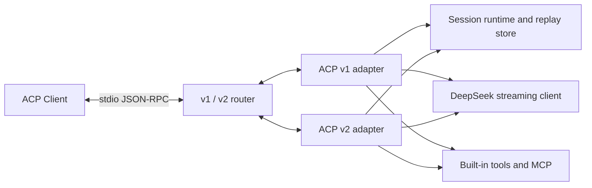

# dsh-acp

**Run a full DeepSeek coding agent in Zed, JetBrains IDEs, and any other
[Agent Client Protocol](https://agentclientprotocol.com/) client.**

[](https://github.com/BrokkAi/dsh-acp/actions/workflows/ci.yml)
[](https://github.com/BrokkAi/dsh-acp/releases/latest)
[](LICENSE)
[](https://www.rust-lang.org/)
[](https://agentclientprotocol.com/)

`dsh-acp` is a DeepSeek-powered coding agent and ACP server built on
`agent-client-protocol` 3.4. It negotiates ACP v2 when the client requests it
and falls back to ACP v1 for older clients.

It is not a chat-only adapter. The agent can stream reasoning and responses,
call filesystem and terminal operations through the ACP client, run local
fallback tools, use permission prompts, consume MCP servers, persist and replay
sessions, switch modes and models, and report token usage.

> `dsh-acp` is an independent community project. DeepSeek is a product of its
> respective owner. This project is not affiliated with, endorsed by, or
> supported by DeepSeek.

## Why dsh-acp

- **ACP v1 and v2:** version negotiation, asynchronous v2 prompt acceptance,
  foreground state, replay cursors, structured diffs, agent-owned terminals,
  and v1 compatibility in one stdio binary.
- **Real coding tools:** workspace-confined file reads and edits, command
  execution, regex search, web fetch, planning, user questions, and MCP tools.
- **Durable sessions:** atomic JSON persistence, resume, replay, fork, list,
  delete, and close with tool outcomes and rendered state restored.
- **Steering:** the ecosystem `_session/steering` extension on both ACP
  versions, including the `promptRequired` idle policy.
- **DeepSeek streaming:** text, reasoning, image prompts, tool-call assembly,
  provider configuration, and current context occupancy.

Detailed compatibility and extension notes live in
[docs/acp-support.md](docs/acp-support.md), with steering behavior in
[docs/steering.md](docs/steering.md).

## Quick start

Install from the repository:

```bash
cargo install --git https://github.com/BrokkAi/dsh-acp
```

Set a DeepSeek API key and launch the stdio server from your ACP client:

```bash
export DEEPSEEK_API_KEY="..."
dsh-acp
```

Example client configuration:

```json
{
  "command": "dsh-acp",
  "args": [],
  "env": {
    "DEEPSEEK_API_KEY": "..."
  }
}
```

ACP traffic uses stdout. Diagnostics and tracing use stderr, so the server is
safe to launch as a client subprocess.

## Build from source

Requirements:

- Rust 1.89 or newer
- A DeepSeek API key, or compatible provider headers
- An ACP client or another process capable of speaking ACP over stdio

```bash
cargo build --release
```

The binary is `target/release/dsh-acp`.

## Configuration

```text
--base-url <URL>                 OpenAI-compatible API root
--model <MODEL>                  Default model (default: deepseek-flash)
--models <A,B>                   Models in the ACP model selector
--data-dir <PATH>                Session storage (default: .dsh-acp)
--permission-mode ask|allow|deny Sensitive-tool policy
--max-tool-rounds <N>            Model/tool round limit
--context-chars <N>              Approximate context budget
--tool-output-bytes <N>          Per-tool output cap
--disable-web                    Disable web_fetch
--trace                          Detailed diagnostics on stderr
```

Every option has an environment fallback; run `dsh-acp --help` for the complete
list.

## ACP support

The server implements both protocol generations through the SDK protocol
router. ACP v2 is primary and v1 is the compatibility path.

ACP v2 includes asynchronous prompt acceptance, foreground `running` /
`requires_action` / `idle` state, patch-style tool calls, v2 replay cursors,
v2 config options, permissions, elicitation, session fork/resume/delete/close,
active-session resume, agent-owned terminal snapshots, structured file diffs,
context-compaction updates, MCP transport declarations, and provider
configuration.

Both protocol versions advertise the ecosystem `_session/steering` extension
through top-level `_meta.steering.supported`, and both accept the
`idleBehaviors: ["promptRequired"]` opt-in. Steering injects a prompt into the
active model loop, and the loop consumes it at the next safe model boundary
before reporting `idle`. An idle steering request with its default behavior
starts a new detached turn; with `idleBehavior: "promptRequired"`, it returns
`promptRequired` so the Client can retain and submit the prompt itself.

ACP v1 includes:

- `initialize`, agent info, capabilities, auth/logout, and optional provider
  configuration APIs
- `session/new`, `session/load`, `session/resume`, `session/fork`,
  `session/list`, `session/delete`, and `session/close`
- `session/prompt`, `session/cancel`, `session/set_mode`, and
  `session/set_config_option`
- `session/update` streaming for agent messages, thoughts, tool calls, tool
  progress/results, modes, config, session info, and token usage
- Agent-to-client permission, filesystem, and terminal requests
- MCP stdio and streamable HTTP server declarations and tool calls
- Session persistence, pagination, replay, forking, system prompts, additional
  workspace roots, and end-of-turn token usage

Both protocol versions advertise the `deepseek-api-key` login method and expose
their corresponding authentication and logout requests. Credentials still come
from the launch environment, CLI, or provider configuration; the protocol login
method re-enables a configured provider rather than carrying a secret inline.

Legacy SSE-only MCP transports are best effort and are not advertised.
MCP-over-ACP requires a proxy component and is not advertised by this
standalone agent.

## Tools

Built-in model tools:

| Tool | Purpose |
| --- | --- |
| `update_plan` | Publish a complete ACP-visible execution plan |
| `ask_user` | Request structured input through ACP elicitation |
| `read_file` | Read text with line ranges |
| `list_directory` | Bounded recursive directory listing |
| `search_files` | Regex content search with path filtering |
| `write_file` | Create or overwrite files |
| `edit_file` | Exact-text replacement with ambiguity checks |
| `run_command` | Execute a command without a shell |
| `web_fetch` | Fetch and extract bounded readable web content |

File paths are restricted to the session working directory and additional
workspace roots. Symlink escapes are rejected. Writes, commands, and MCP tools
go through ACP permission requests unless the session policy or a prior
"allow always" decision permits them. `web_fetch` rejects localhost, private,
link-local, and multicast destinations for both direct requests and redirects.

In v1, when the ACP client advertises filesystem and terminal capabilities,
the corresponding reverse requests are used. Local implementations are
available as fallbacks. ACP v2 no longer exposes those client capabilities, so
v2 uses the local workspace tools directly.

MCP tools are exposed to the model as
`mcp__<server>__<tool>`. Both stdio servers and modern streamable HTTP servers
are supported; a session can declare multiple servers.

## DeepSeek behavior

Responses use DeepSeek's OpenAI-compatible streaming API. Reasoning chunks are
forwarded as ACP thought updates. Tool calls are assembled from streamed
fragments, executed sequentially, returned as tool messages, and fed back to
the model until it finishes or the configured round limit is reached.

`deepseek-flash` supports JPEG, PNG, GIF, and WebP image inputs. ACP image
content is translated into DeepSeek/OpenAI-compatible `image_url` parts and is
retained in session history for replay.

`ask_user` uses ACP form elicitation by default. When the Client advertises URL
elicitation, the model may also request an HTTPS URL with an optional stable
`elicitation_id`. Embedded URL credentials and plain HTTP outside localhost are
rejected.

Session model and permission configuration is available through ACP config
options. The in-conversation commands `/help`, `/plan`, `/agent`, `/model`, and
`/status` are also supported.

## Persistence

Sessions are stored as readable JSON under:

```text
<data-dir>/sessions/<session-id>.json
```

Writes are atomic. The transcript includes text, reasoning, original prompt
content blocks, tool calls, structured tool outcomes and raw outputs, diffs,
terminal snapshots, plans, compactions, configuration, timestamps,
parent-session links, cumulative token usage, and current context occupancy.
Replay restores failed and cancelled tool statuses, rendered diffs and patches,
terminal state, plans, compactions, and image/resource prompt content.

## Architecture

One process hosts both ACP protocol implementations through the SDK protocol
router:



The v1 and v2 wire surfaces stay separate while sharing session records, model
transport, and tool execution. A request routed to v2 never receives a v1
projection, and unexpected protocol fields are left to the SDK's extensible
types rather than rejected by this application.

See [docs/architecture.md](docs/architecture.md) for the lifecycle, storage,
security boundaries, and concurrency model.

## Security model

- File tools are confined to the session `cwd` and additional workspace roots,
  with symlink and lexical escape checks.
- Writes, commands, and MCP calls request ACP permission unless policy or an
  in-session "allow always" decision authorizes them.
- `web_fetch` rejects loopback, private, link-local, multicast, and unsafe
  redirect targets.
- Credentials are read from launch configuration or provider requests and are
  not written to session transcripts.

Report vulnerabilities privately according to [SECURITY.md](SECURITY.md).

## Verification

```bash
cargo fmt --check
cargo clippy --locked --all-targets -- -D warnings
cargo test --locked
cargo build --release --locked
```

The integration suite performs real ACP v1 and v2 stdio handshakes and runs
mocked DeepSeek streams through complete tool round trips, permissions, and
cancellation. Binding its loopback mock server may require network permission
in heavily sandboxed environments.

## Documentation

- [ACP support matrix](docs/acp-support.md)
- [Architecture and lifecycle](docs/architecture.md)
- [Steering extension](docs/steering.md)
- [Contributing](CONTRIBUTING.md)
- [Changelog](CHANGELOG.md)
- [Release process](RELEASING.md)

## License

MIT. See [LICENSE](LICENSE).

