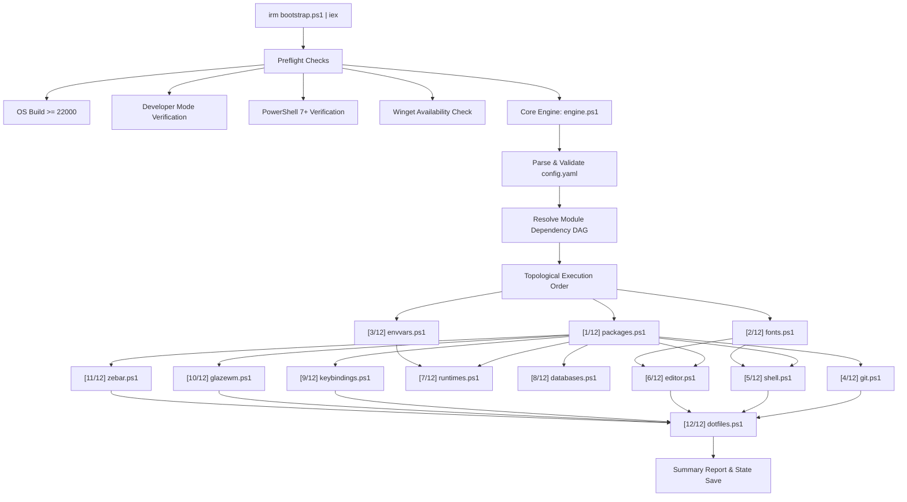

<p align="center">
  
</p>

<h1 align="center">devbox-win</h1>

<p align="center">
  <strong>Native Windows 11 Developer Machine Provisioner</strong><br>
  Zero-dependency declarative YAML &bull; Kahn's DAG topological engine &bull; Unprivileged symlinks &bull; Curated GlazeWM, Zebar &amp; Zed rice
</p>

<p align="center">
  <a href="https://github.com/belal-waheed/devbox-win/actions"></a>
  <a href="https://belal-waheed.github.io/devbox-win/"></a>
  
  
  <a href="#license"></a>
</p>

---

## Overview

`devbox-win` brings the reproducible dotfiles and provisioning culture of Linux and macOS to native Windows 11. It provisions modern toolchains, developer fonts, shell environments, editor settings, language compilers, database clients, keybindings, and tiling window managers in a single unattended execution.

- **Zero dependencies**: Written entirely in PowerShell 7+. The bootstrap script automatically self-installs `pwsh` from Windows PowerShell 5.1 if needed and triggers an elevate-once prompt for Developer Mode unprivileged symlinks.
- **Native package management**: Uses Microsoft's official `winget` toolchain with silent unattended installations and a 180s circuit breaker process timeout.
- **Declarative YAML config**: All software, git credentials, prompt themes, fonts, runtimes, and dotfile links are declared in `config.yaml`.
- **Role-Based Presets**: Instant starter profiles for `belal-catppuccin` (Author Signature Rice), `frontend`, `backend`, `fullstack`, `devops`, or `minimal` workstations.
- **First-Class Editors**: Independent, parallel synchronization for both Visual Studio Code and the high-performance Zed editor (`Zed.Zed`).
- **Machine Health Doctor**: Built-in health audit (`-Doctor`) checking OS build, Dev Mode, PowerShell 7+, execution policy, long paths, network reachability, git identity, and symlink health.
- **Workstation State Exporter**: Reverse-engineers active machine packages, runtimes, fonts, and window managers into a valid declarative `config.exported.yaml` (`-Export`).
- **Community Module Marketplace**: Extensible catalog of custom community modules (`-Marketplace`, `-InstallModule`) with strict contract validation and dynamic DAG integration.
- **Cross-Machine Synchronization**: Two-way Git sync (`-Sync -Push` / `-Sync -Pull`) tracking dotfiles and config updates across machines with conflict detection and automated DAG re-apply.
- **Secure Backup & Disaster Recovery**: Comprehensive `.zip` snapshots with companion SHA256 checksums, pre-restore safety snapshots, sandbox extraction, and optional SSH keys (`-Backup`, `-Restore`).
- **Visual Companion Dashboard**: Standalone HTML/CSS/JS dashboard launched in Microsoft Edge app mode displaying real-time machine health, runtime toolchains, and one-click CLI operations (`-Dashboard`).
- **ANSI Cursor-Driven Wizard**: Guided keyboard-driven terminal setup with Up/Down arrow navigation, Spacebar toggle, Select All/None, and robust stream fallback.
- **12 Specialized Modules + Community Extensions**: Complete coverage across packages, fonts, envvars, git, shell, editor, runtimes, databases, keybindings, GlazeWM, Zebar, dotfiles, gaming, and AI tools.
- **Dependency DAG**: Modules execute in topologically sorted order, guaranteeing prerequisites run before dependants.
- **True idempotency**: Every module tests current system state before modifying. Safe to re-run at any time.
- **Reboot-Resume Mechanism**: Automatically registers a Windows RunOnce resume entry when a reboot is required and seamlessly continues uncompleted modules.
- **Non-destructive dotfiles**: Existing files are automatically backed up to `~/.devbox-win/backups/` before symlinks are established.
- **Clean uninstall**: Every action is recorded in `~/.devbox-win/manifest.json` for precise reverts.
- **Zero emojis**: Professional, high-density ANSI terminal interface with structured status badges.

---

## Quickstart

### Remote One-Liner
Open Windows Terminal or PowerShell and run:

```powershell
irm https://raw.githubusercontent.com/<your-username>/devbox-win/main/bootstrap.ps1 | iex
```

### Local Execution
Clone your fork locally and run:

```powershell
pwsh -NoProfile -ExecutionPolicy Bypass -File bootstrap.ps1
```

To run the interactive first-time setup wizard:

```powershell
pwsh -NoProfile -ExecutionPolicy Bypass -File core/wizard.ps1
```

To perform a safe simulation without applying any changes:

```powershell
pwsh -NoProfile -ExecutionPolicy Bypass -File bootstrap.ps1 -DryRun
```

---

## System Requirements

| Prerequisite | Minimum Version | Notes |
|---|---|---|
| **Operating System** | Windows 11 (Build 22000+) | Requires modern App Installer and dev subsystem |
| **Developer Mode** | Enabled | Enables unprivileged symlinks without UAC prompts |
| **Package Manager** | `winget` (Windows App Installer) | Built into Windows 11 |
| **PowerShell** | PowerShell 7.2+ (`pwsh`) | Bootstrapped automatically if running in 5.1 |

---

## Architecture & Module Dependency DAG



### The 12 Provisioning Modules

| Module | Description | Dependencies | Idempotency Check |
|---|---|---|---|
| **`packages`** | Installs toolchain via `winget` (silent, 180s circuit breaker) | None | `winget list --id <id>` |
| **`fonts`** | Installs Nerd Fonts into Windows registry | None | Registry check in `HKLM` / `HKCU` fonts |
| **`envvars`** | Configures user environment variables & PATH | None | Compares current registry value before updating |
| **`git`** | Sets global git identity & generates ed25519 SSH keys | `packages` | Reads `git config --global`, tests `~/.ssh/id_ed25519` |
| **`shell`** | Windows Terminal settings & PowerShell 7 profile | `packages`, `fonts` | Compares symlink target path against source |
| **`editor`** | VS Code & Zed editor settings, keybindings, & extensions | `packages`, `fonts` | Tests existing symlinks, queries `code --list-extensions` |
| **`runtimes`** | Node (`nvm`/`fnm`), Python, Rust (`rustup`), .NET SDKs | `packages`, `envvars` | Checks `node -v`, `python -v`, `rustup`, `dotnet --list-sdks` |
| **`databases`** | PostgreSQL, Redis, MongoDB clients & engines | `packages` | CLI binary detection (`psql`, `redis-cli`, `mongosh`) |
| **`keybindings`**| PowerToys & AutoHotkey v2 shortcuts | `packages` | Verifies package state & startup shortcut path |
| **`glazewm`** | GlazeWM tiling window manager (DWM cloak) & autostart | `packages` | Verifies binary path, config path, & startup shortcut |
| **`zebar`** | Zebar status bar (settings & Nord pack) & autostart | `packages` | Verifies binary path, config path, & startup shortcut |
| **`dotfiles`** | Dotfile symlink coordinator (git, shell, WM, AHK) | All upstream | `Test-DevboxSymlinkTarget` with automatic backup |

---

## Role-Based Presets

Presets provide curated, battle-tested configurations for specific developer roles. When a preset is declared in `config.yaml`, its defaults are automatically merged under your explicit settings:

| Preset | Target Workflow | Key Tools & Runtimes |
|---|---|---|
| **`belal-catppuccin`** | Author Signature Rice (Default) | GlazeWM (DWM cloaking + `#cba6f7` lavender border), Zebar (Nord pack), Zed + VS Code, Starship, fnm/Node, pyenv/Python, Rust, .NET 8/9, Postgres, Docker |
| **`frontend`** | React, Vue, Svelte, Web | VS Code, Chrome, Firefox, Node (nvm), Starship, JetBrainsMono |
| **`backend`** | C#/.NET, Python, Go, Rust | .NET SDKs, Python, Rust, Docker, PostgreSQL, Redis, Postman |
| **`fullstack`**| Complete end-to-end dev | Node, .NET, Python, Rust, Docker, Postgres, GlazeWM, Zebar, AHK |
| **`devops`** | Cloud, Containers, Infra | Docker Desktop, kubectl, Helm, cloud CLIs, Terminal, Starship |
| **`minimal`** | Clean terminal baseline | Git, Windows Terminal, Starship prompt, JetBrainsMono Nerd Font |

You can specify a preset directly in `config.yaml`:
```yaml
preset: backend
```

Or override it on the command line:
```powershell
pwsh -NoProfile -File core/engine.ps1 -Preset frontend
```

---

## Reboot-Resume Workflow

Some Windows software (such as runtime installers or system path refreshers) requires a restart before changes become active. `devbox-win` handles this automatically:

1. If a module signals a required reboot, the engine marks `needsReboot: true` in `~/.devbox-win/state.json`.
2. It registers a RunOnce entry at `HKCU:\Software\Microsoft\Windows\CurrentVersion\RunOnce\DevboxWinResume`.
3. After rebooting and logging in, Windows launches `pwsh -NoProfile -File core/engine.ps1 -Resume`.
4. The engine checks previously completed modules, skips them, and continues execution from the first remaining uncompleted module.

You can also manually trigger a resume at any time:
```powershell
pwsh -NoProfile -File core/engine.ps1 -Resume
```

---

## Repository Structure

```
devbox-win/
├── .github/                   # GitHub Actions CI/CD & Community Templates
│   ├── workflows/
│   │   └── ci.yml             # Windows-latest automated CI pipeline
│   ├── ISSUE_TEMPLATE/
│   │   ├── bug_report.yml     # Structured bug report issue form
│   │   ├── feature_request.yml# Feature enhancement proposal form
│   │   └── new_preset.yml     # Community stack preset contribution form
│   └── PULL_REQUEST_TEMPLATE.md# Pull request quality & verification checklist
│
├── bootstrap.ps1              # Remote entry point and runtime bootstrap
├── config.example.yaml        # Full commented reference configuration
├── config.yaml                # Active ready-to-run configuration
├── README.md                  # Documentation and architecture guide
│
├── core/                      # Engine components
│   ├── engine.ps1             # 12-module DAG resolver and orchestrator
│   ├── config.ps1             # Zero-dependency YAML parser, validator, preset merge
│   ├── doctor.ps1             # System health, toolchain, and symlink diagnostic auditor
│   ├── export.ps1             # Reverse-engineer active machine state into YAML
│   ├── marketplace.ps1        # Community module discovery, contract validation, and installer
│   ├── sync.ps1               # Cross-machine two-way Git synchronization (push/pull)
│   ├── backup.ps1             # Secure compressed archive snapshots & disaster recovery
│   ├── dashboard.ps1          # Standalone visual HTML dashboard (Microsoft Edge app mode)
│   ├── logger.ps1             # ANSI TUI banner, steps, and status badges
│   ├── symlink.ps1            # Idempotent symlink engine with backups
│   ├── state.ps1              # State persistence (~/.devbox-win/state.json) & reboot resume
│   ├── manifest.ps1           # Modification tracking and clean uninstall
│   └── wizard.ps1             # Interactive first-time setup wizard
│
├── presets/                   # Role-based preset configurations
│   ├── belal-catppuccin.yaml  # Author signature Catppuccin tiling desktop (Default)
│   ├── frontend.yaml          # Web / Frontend stack
│   ├── backend.yaml           # C# / .NET / Python / Databases stack
│   ├── fullstack.yaml         # Complete development & tiling WM stack
│   ├── devops.yaml            # Containers / Kubernetes / Cloud stack
│   └── minimal.yaml           # Lightweight terminal baseline
│
├── modules/                   # 12 core idempotent modules + community extensions
│   ├── packages.ps1           # Winget silent installer (180s circuit breaker)
│   ├── fonts.ps1              # Nerd Font registry installer
│   ├── envvars.ps1            # Environment variables and safe PATH modification
│   ├── git.ps1                # Git global config and ed25519 keygen
│   ├── shell.ps1              # Windows Terminal and PowerShell profile
│   ├── editor.ps1             # VS Code & Zed editor settings, keys, and extensions
│   ├── runtimes.ps1           # Node (nvm/fnm), Python, Rust, .NET SDKs
│   ├── databases.ps1          # PostgreSQL, Redis, MongoDB clients & engines
│   ├── keybindings.ps1        # PowerToys and AutoHotkey v2 shortcuts
│   ├── glazewm.ps1            # GlazeWM tiling window manager (DWM cloaking)
│   ├── zebar.ps1              # Zebar status bar (settings & Nord pack)
│   ├── dotfiles.ps1           # Dotfile symlink coordinator
│   └── community/             # Extensible community module ecosystem
│       ├── gaming.ps1         # Gaming toolchain (Steam, OBS Studio, Discord)
│       └── ai-tools.ps1       # Local AI stack (Ollama, LM Studio, Hugging Face CLI)
│
├── dotfiles/                  # Curated configurations (symlinked to system)
│   ├── .gitconfig             # Git aliases and settings
│   ├── terminal/
│   │   └── settings.json      # Windows Terminal profile & One Half Dark
│   ├── pwsh/
│   │   └── Microsoft.PowerShell_profile.ps1 # PSReadLine & prompt setup
│   ├── vscode/
│   │   ├── settings.json      # Editor typography, formatting, ligatures
│   │   ├── keybindings.json   # Custom keybindings
│   │   └── extensions.txt     # Batch extension list
│   ├── zed/
│   │   └── settings.json      # Zed editor typography, Catppuccin theme, pwsh terminal
│   ├── glazewm/
│   │   └── config.yaml        # GlazeWM hardware DWM cloaking & Catppuccin borders
│   ├── zebar/
│   │   ├── settings.json      # Zebar v3+ settings
│   │   ├── config.yaml        # Legacy Zebar configuration fallback
│   │   └── packs/
│   │       └── nord/          # Curated Nord status bar theme pack
│   ├── starship/
│   │   └── starship.toml      # High-performance minimalist prompt
│   └── ahk/
│       └── hotkeys.ahk        # Productive window management hotkeys
│
└── tests/                     # Automated test suite
    └── engine.tests.ps1       # Comprehensive AAA verification test suite
```

---

## Configuration Reference (`config.yaml`)

```yaml
user:
  name: "Your Name"
  email: "you@example.com"
  github_username: "yourgithub"

preset: fullstack

modules:
  packages: true
  fonts: true
  envvars: true
  git: true
  shell: true
  editor: true
  runtimes: true
  databases: true
  keybindings: true
  glazewm: true
  zebar: true
  dotfiles: true

packages:
  - Microsoft.VisualStudioCode
  - Git.Git
  - GitHub.cli
  - Microsoft.WindowsTerminal
  - Starship.Starship
  - 7zip.7zip
  - DEVCOM.JetBrainsMonoNerdFont
  - glzr-io.glazewm
  - glzr-io.zebar

runtimes:
  node:
    manager: nvm
    default_version: lts
  python:
    manager: pyenv-win
    default_version: "3.12"
  rust:
    install: true
  dotnet:
    versions: ["8.0"]

databases:
  - PostgreSQL.PostgreSQL
  - Redis.Redis

keybindings:
  powertoys: true
  autohotkey: true
  startup_script: true

glazewm:
  install: true
  autostart: true

zebar:
  install: true
  autostart: true

envvars:
  EDITOR: code
  DEVBOX_WIN: "true"
```

---

## Command Reference

### Complete CLI Reference Guide

| Command Option | Parameter Type | Description | Example Syntax |
|---|---|---|---|
| *(default apply)* | None | Orchestrates and applies all 12 modules according to `config.yaml` | `pwsh -NoProfile -File core/engine.ps1` |
| `-Doctor` | Switch | Audits machine health, Developer Mode, long paths, network, symlinks | `pwsh -NoProfile -File core/engine.ps1 -Doctor` |
| `-Export` | Switch | Reverse-engineers machine toolchains & catalog packages into YAML | `pwsh -NoProfile -File core/engine.ps1 -Export` |
| `-ExportPath <path>` | String | Destination path for the reverse-engineered YAML configuration | `pwsh -NoProfile -File core/engine.ps1 -Export -ExportPath config.exported.yaml` |
| `-Sync` | Switch | Checks Git synchronization status between local workstation and fork | `pwsh -NoProfile -File core/engine.ps1 -Sync` |
| `-Sync -Pull` | Switch | Pulls remote fork updates, fast-forward merges, and re-applies DAG | `pwsh -NoProfile -File core/engine.ps1 -Sync -Pull` |
| `-Sync -Push` | Switch | Detects changed workstation configs, commits, and pushes to fork | `pwsh -NoProfile -File core/engine.ps1 -Sync -Push` |
| `-Backup` | Switch | Creates compressed `.zip` backup snapshot of configs, dotfiles, state | `pwsh -NoProfile -File core/engine.ps1 -Backup` |
| `-BackupPath <path>` | String | Custom destination archive path for backup or restore | `pwsh -NoProfile -File core/engine.ps1 -Backup -BackupPath "D:\backup.zip"` |
| `-IncludeSSHKeys` | Switch | Includes SSH private/public keys in backup with security notice | `pwsh -NoProfile -File core/engine.ps1 -Backup -IncludeSSHKeys` |
| `-Restore` | Switch | Restores workstation configs, dotfiles, and symlinks from backup zip | `pwsh -NoProfile -File core/engine.ps1 -Restore -BackupPath "D:\backup.zip"` |
| `-Marketplace` | Switch | Displays installed community extensions and curated catalog | `pwsh -NoProfile -File core/engine.ps1 -Marketplace` |
| `-InstallModule <name\|url>` | String | Installs a community extension by catalog name or direct URL | `pwsh -NoProfile -File core/engine.ps1 -InstallModule gaming` |
| `-Dashboard` | Switch | Generates visual health companion and launches in Edge app mode | `pwsh -NoProfile -File core/engine.ps1 -Dashboard` |
| `-DryRun` | Switch | Simulates all module actions without modifying files or installing packages | `pwsh -NoProfile -File core/engine.ps1 -DryRun` |
| `-Preset <name>` | String | Overrides config preset (`frontend`, `backend`, `fullstack`, `devops`, `minimal`) | `pwsh -NoProfile -File core/engine.ps1 -Preset fullstack` |
| `-Wizard` | Switch | Launches the interactive guided setup wizard to generate `config.yaml` | `pwsh -NoProfile -File core/engine.ps1 -Wizard` |
| `-Resume` | Switch | Resumes provisioning after reboot, skipping completed modules | `pwsh -NoProfile -File core/engine.ps1 -Resume` |
| `-Retry` | Switch | Retries only modules recorded as failed in the previous run | `pwsh -NoProfile -File core/engine.ps1 -Retry` |
| `-Module <name>` | String | Executes a single specific module in isolation (`runtimes`, `gaming`, etc.) | `pwsh -NoProfile -File core/engine.ps1 -Module runtimes` |
| `-ConfigFile <path>` | String | Uses an alternate YAML configuration file | `pwsh -NoProfile -File core/engine.ps1 -ConfigFile custom.yaml` |
| `-Uninstall` | Switch | Reverts created symlinks, startup shortcuts, and restores backups | `pwsh -NoProfile -File core/engine.ps1 -Uninstall` |
| `-UninstallPackages` | Switch | In combination with `-Uninstall`, removes all winget packages installed | `pwsh -NoProfile -File core/engine.ps1 -Uninstall -UninstallPackages` |
| `-Help` | Switch | Displays the CLI usage manual and command guide | `pwsh -NoProfile -File core/engine.ps1 -Help` |

---

### Machine Health Doctor (`-Doctor`)

Run a comprehensive machine health audit to diagnose environment readiness, platform capabilities, and broken symlinks:

```powershell
pwsh -NoProfile -File core/engine.ps1 -Doctor
# or via bootstrap:
pwsh -NoProfile -File bootstrap.ps1 -Doctor
```

What the Doctor audits:
- **Windows 11 Build**: Validates OS build >= 22000.
- **Developer Mode**: Checks `AppModelUnlock` registry for unprivileged symlink permissions.
- **PowerShell 7+ & Execution Policy**: Verifies modern runtime and unblocked script policy.
- **Long Paths Support**: Verifies `LongPathsEnabled` registry key (Win32 MAX_PATH removal).
- **Winget Toolchain**: Verifies `winget` CLI health and version.
- **Network Reachability**: Tests low-latency HTTP connectivity to `github.com` and `raw.githubusercontent.com`.
- **Git Identity**: Validates Git CLI installation and configured `user.name` and `user.email`.
- **Symlink Integrity**: Cross-references `~/.devbox-win/manifest.json` against filesystem reparse points to report any broken or orphaned links.
- **Toolchain Inventory**: Detects VS Code, Windows Terminal, Starship, Node.js, Python, Rust, .NET SDKs, GlazeWM, and Zebar.

---

### Workstation State Exporter (`-Export`)

Capture the current state of an already-configured machine and reverse-engineer a clean, declarative `config.exported.yaml`:

```powershell
pwsh -NoProfile -File core/engine.ps1 -Export
# Or specify a custom output destination:
pwsh -NoProfile -File core/engine.ps1 -Export -ExportPath "my-machine.yaml"
```

What the Exporter extracts:
- User identity (`user.name`, `user.email`, `github.user` from Git and GitHub CLI).
- Installed Winget packages matching the devbox catalog.
- Active language runtimes and compilers (Node.js version and manager, Python version, Rust toolchain, installed .NET SDK versions).
- Installed Nerd Font families from the Windows Fonts registry (JetBrainsMono, CascadiaCode, FiraCode, Meslo).
- Active GlazeWM tiling window manager and Zebar status bar configurations.
- Synthesizes a valid, commented YAML document ready to commit to your personal fork.

---

### Community Module Marketplace (`-Marketplace`, `-InstallModule`)

Extend your workstation setup with specialized, community-authored modules located in `modules/community/`. Community modules are automatically integrated into the dependency DAG and support full idempotency and dry-run modes.

```powershell
# Browse installed community modules and curated catalog
pwsh -NoProfile -File core/engine.ps1 -Marketplace

# Install a community module by catalog name
pwsh -NoProfile -File core/engine.ps1 -InstallModule gaming

# Install a community module directly from a trusted URL
pwsh -NoProfile -File core/engine.ps1 -InstallModule https://example.com/custom.ps1

# Run a specific community module in isolation
pwsh -NoProfile -File core/engine.ps1 -Module gaming -DryRun
```

#### Community Module Contract
Every community module must conform to the standard devbox-win extension contract:
- `Get-ModuleMetadata`: Returns hashtable with `Name`, `Description`, `Dependencies`, and `Packages`.
- `Test-TargetState`: Idempotency guard returning `$true` if target components are already satisfied.
- `Invoke-Module`: Accepts `($Config, [switch]$DryRun)` and returns structured status (`OK`, `SKIP`, `FAIL`).

#### Bundled Community Modules
- **`modules/community/gaming.ps1`**: Steam (`Valve.Steam`), OBS Studio (`OBSProject.OBSStudio`), Discord (`Discord.Discord`).
- **`modules/community/ai-tools.ps1`**: Ollama (`Ollama.Ollama`), LM Studio (`ElementLabs.LMStudio`), Hugging Face CLI.

To activate installed community modules in full DAG execution, add them to `config.yaml`:
```yaml
community_modules:
  - gaming
  - ai-tools
```

---

### Cross-Machine Synchronization (`-Sync`, `-Push`, `-Pull`)

Keep multiple Windows 11 development workstations perfectly aligned through your Git fork:

```powershell
# Check synchronization status (ahead/behind counts, modified dotfiles)
pwsh -NoProfile -File core/engine.ps1 -Sync

# Stage local config/dotfile changes, commit with Conventional Commit, and push to fork
pwsh -NoProfile -File core/engine.ps1 -Sync -Push

# Fetch and fast-forward pull remote updates, then trigger an idempotent DAG re-apply
pwsh -NoProfile -File core/engine.ps1 -Sync -Pull

# Preview synchronization actions without modifying files
pwsh -NoProfile -File core/engine.ps1 -Sync -Pull -DryRun
```

- **Conflict Prevention**: Verifies working tree cleanliness before pulling to prevent merge conflicts.
- **Automated Re-Apply**: Automatically triggers dotfile symlink and configuration refresh when pulled commits modify `config.yaml` or `dotfiles/`.
- **Conventional Commits**: Automatically generates standard commit messages: `chore(sync): update workstation configs [timestamp]`.

---

### Secure Backup & Disaster Recovery (`-Backup`, `-Restore`)

Create portable, self-contained, compressed `.zip` recovery packages of your workstation configuration and restore them seamlessly:

```powershell
# Create standard workstation backup (config.yaml, dotfiles, state, manifest)
pwsh -NoProfile -File core/engine.ps1 -Backup

# Include SSH keys in the backup archive with security notice
pwsh -NoProfile -File core/engine.ps1 -Backup -IncludeSSHKeys

# Specify a custom backup archive destination
pwsh -NoProfile -File core/engine.ps1 -Backup -BackupPath "D:\devbox-backup.zip"

# Preview restoration in dry-run mode without altering files
pwsh -NoProfile -File core/engine.ps1 -Restore -BackupPath "D:\devbox-backup.zip" -DryRun

# Restore configurations, state, and symlinks from a backup package
pwsh -NoProfile -File core/engine.ps1 -Restore -BackupPath "D:\devbox-backup.zip"
```

- **Cryptographic Verification**: Computes SHA256 hashes for all packaged files and writes a companion `.sha256` checksum file to guarantee archive integrity.
- **Safety Pre-Restore Snapshot**: Automatically snapshots existing files to `~/.devbox-win/backups/pre-restore-<timestamp>/` before overwriting anything.
- **Safe Sandboxing**: Extracts archives to isolated temporary sandboxes and validates `backup-metadata.json` before touching production paths.
- **Symlink Refresh**: Re-links all system dotfile symlinks after restoration is complete.

---

### Visual Dashboard Companion (`-Dashboard`)

Launch a standalone, dark-themed visual companion dashboard running directly in Microsoft Edge app mode without external web servers:

```powershell
# Generate dashboard and open in Microsoft Edge app window
pwsh -NoProfile -File core/engine.ps1 -Dashboard

# Generate standalone HTML file without launching browser
pwsh -NoProfile -File core/engine.ps1 -Dashboard -NoLaunch
```

- **Design Integrity**: Dark-neutral OKLCH color palette, 8px spatial grid, Inter typography, clean vector SVG icons, and zero emojis.
- **Live Diagnostics**: Displays machine health audits from Doctor diagnostics, installed runtimes, and active package inventory.
- **Tiling WM & Status Bar**: Displays real-time process state for GlazeWM and Zebar.
- **One-Click CLI Operations**: Interactive cards with one-click copyable PowerShell commands and clipboard toast notifications.

---

### ANSI Cursor-Driven Setup Wizard (`-Wizard`)

Launch the guided setup wizard to generate a new `config.yaml` using a keyboard-navigable ANSI cursor-driven interface:
```powershell
pwsh -NoProfile -File core/engine.ps1 -Wizard
# or directly
pwsh -NoProfile -File core/wizard.ps1
```

- **ANSI Cursor Navigation**:
  - `↑` / `↓` (Arrow Keys): Navigate items.
  - `Space`: Toggle item selection status (`[*] / [ ]`).
  - `A`: Select all items in current category.
  - `N`: Deselect all items in current category.
  - `Enter`: Confirm selection and proceed to next category.
- **5 Progressive Selection Categories**:
  1. **User Identity**: Developer Name, Git Email, and GitHub username.
  2. **Author Signature Rice**: Pre-selected default for Belal's curated tiling desktop (GlazeWM DWM cloaking + Nord Zebar + AHK hotkeys), or opt-out to standard Windows desktop.
  3. **IDEs & Code Editors**: Visual Studio Code, Zed Editor, Cursor, and Neovim.
  4. **Languages & Runtimes**: Node.js (via fnm), Python (via pyenv-win), Rust (cargo/rustup), .NET SDK (8.0/9.0), and Go.
  5. **Terminal & Fonts**: Windows Terminal, Starship prompt, JetBrainsMono Nerd Font, and CascadiaCode Nerd Font.
  6. **Containers & Databases**: PostgreSQL Client & Server, Docker Desktop, Redis, and MongoDB Compass.
- **Headless & Stream Fallback**: Automatically detects non-interactive or redirected streams (`-NonInteractive`), falling back to comma-separated numeric input or automated default generation without deadlocks.

---

### First-Class Zed Editor Integration

`devbox-win` supports the high-performance [Zed editor](https://zed.dev) alongside Visual Studio Code:
- **Package Installation**: Automated silent installation via `Zed.Zed` winget package.
- **Dual Setting Symlinks**: Simultaneously links `dotfiles/zed/settings.json` to both `~/.config/zed/settings.json` and `%APPDATA%\Zed\settings.json`.
- **Preconfigured Tuning**: Bundled with JetBrainsMono Nerd Font, Catppuccin Mocha theme, autosave on focus change, and PowerShell 7 terminal integration.

---

### Dry-Run Simulation (`-DryRun`)

Inspect exactly what would be modified without altering files or installing packages:
```powershell
pwsh -NoProfile -File core/engine.ps1 -DryRun
```

---

### Clean Uninstall & Revert (`-Uninstall`)

Safely remove all created symlinks and startup shortcuts, and restore original backups:
```powershell
pwsh -NoProfile -File core/engine.ps1 -Uninstall
```
To also uninstall all winget packages installed during setup:
```powershell
pwsh -NoProfile -File core/engine.ps1 -Uninstall -UninstallPackages
```

---

## Community & Contributing

Contributions from the developer community are welcomed. Please follow these guidelines:

### Submitting a New Developer Stack Preset
1. Create a new preset YAML file under `presets/<stack-name>.yaml` (e.g. `presets/datascience.yaml` or `presets/flutter.yaml`).
2. Test the preset locally: `pwsh -NoProfile -File core/engine.ps1 -DryRun -Preset <stack-name>`.
3. Open a Pull Request using the [Preset Proposal Form](.github/ISSUE_TEMPLATE/new_preset.yml).

### Quality Standards for Contributions
All pull requests must satisfy our mandatory quality gates:
- **PowerShell AST Syntax Check**: All `.ps1` scripts must parse with 0 AST errors.
- **Unit Test Suite**: `pwsh -NoProfile -File tests/engine.tests.ps1` must pass 100% of tests.
- **Zero Emojis Enforced**: We strictly enforce zero emojis in code, terminal output, error messages, and documentation. Use clean ANSI badges (`[OK]`, `[SKIP]`, `[FAIL]`, `[WARN]`, `[INFO]`, `[FIX]`).
- **Idempotency**: All modules must verify current state before modifying the system.
- **Defensive Backups**: Existing user files must always be backed up to `~/.devbox-win/backups/` before any symlink is created.

---

## How to Fork & Customize

1. **Fork the repository** on GitHub: `https://github.com/belal-waheed/devbox-win` -> `https://github.com/<your-username>/devbox-win`.
2. **Run the Wizard**: Run `pwsh -NoProfile -File core/wizard.ps1` to configure your name, email, and preset.
3. **Customize your dotfiles**:
   - Add your preferred VS Code extensions to `dotfiles/vscode/extensions.txt`.
   - Customize GlazeWM tiling hotkeys in `dotfiles/glazewm/config.yaml`.
   - Customize AutoHotkey shortcuts in `dotfiles/ahk/hotkeys.ahk`.
   - Tweak your Starship prompt in `dotfiles/starship/starship.toml`.
4. **Push your changes** to your `main` branch.
5. **Run your one-liner on any fresh Windows 11 machine**:
   ```powershell
   irm https://raw.githubusercontent.com/<your-username>/devbox-win/main/bootstrap.ps1 | iex
   ```

---

## Troubleshooting

### Windows Developer Mode
Creating symbolic links without elevation requires Developer Mode.
- To enable manually: Open **Windows Settings** -> **System** -> **For developers** -> Toggle **Developer Mode** to **On**.
- Or run `bootstrap.ps1` once from an elevated PowerShell window; it will configure `HKLM:\SOFTWARE\Microsoft\Windows\CurrentVersion\AppModelUnlock\AllowDevelopmentWithoutDevLicense`.

### PowerShell Execution Policy
If script execution is blocked on a fresh installation:
```powershell
Set-ExecutionPolicy -ExecutionPolicy RemoteSigned -Scope CurrentUser
```

### Restoring Backups
All files overwritten by symlinks are backed up to:
```
~/.devbox-win/backups/<timestamp>/
```
Running `core/engine.ps1 -Uninstall` automatically restores these original files to their initial paths.

---

## Testing

Run the included verification suite to validate all 12 modules, AST syntax, parser integrity, preset resolution, wizard generation, reboot-resume checkpoints, doctor diagnostics, workstation exporter, and symlink mechanics:

```powershell
pwsh -NoProfile -File tests/engine.tests.ps1
```

---

## License

MIT License. Free for personal and commercial use.
