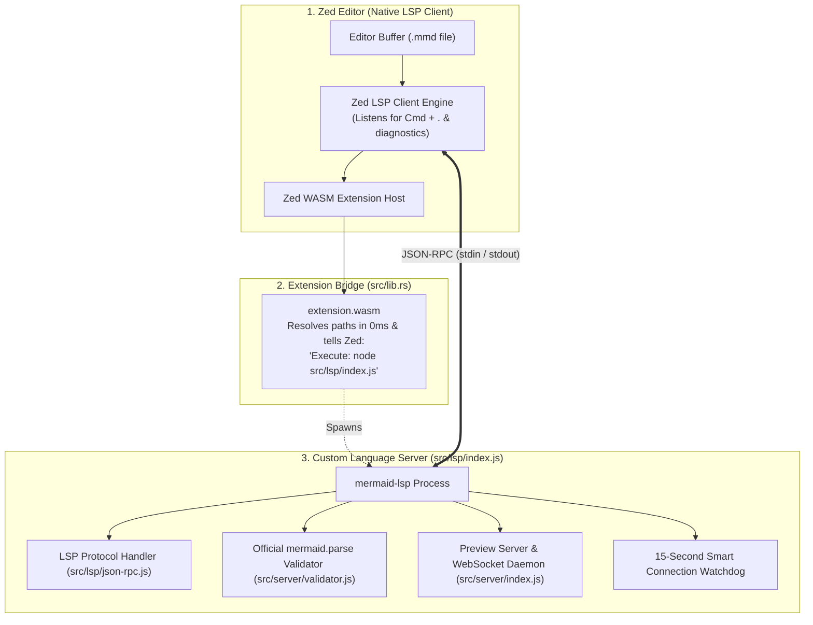

# Mermaid Preview for Zed (still in development)

High-fidelity interactive live preview and language support for **Mermaid** diagrams (`.mmd`, `.mermaid`) in the [Zed code editor](https://zed.dev). Zero-configuration for local workflows, with simple 1-step port forwarding for remote SSH development.

---

## Features

* **100% Diagram Fidelity:** Powered by the official `mermaid.js` engine (v12+). Supports flowcharts, sequence diagrams, class diagrams, state machines, ER diagrams, Gantt charts, Git graphs, mindmaps, and directives (`%%{init}%%`).
* **Zero Configuration Locally:** Automatically allocates a free local port, serves web assets, and launches your default browser via Zed's native `window/showDocument` LSP protocol.
* **Non-Disruptive Real-Time Sync:** As you edit code in Zed, the diagram updates live via WebSockets without stealing your cursor focus or resetting your scroll position.
* **State-Preserving Viewport Controls:**
  * 🔍 **Fit to Screen:** Instantly scales complex diagrams to fit your display.
  * 🎯 **Center View:** Re-centers without altering current zoom scale.
  * 🔄 **Reset 100%:** Restores natural 1:1 scale.
  * ➕ / ➖ Smooth mouse-wheel & touchpad pinch-to-zoom and click-and-drag panning.
* **Instant Exports:** One-click **Copy SVG** to clipboard or download **High-Res 2x PNG**.
* **In-Editor Syntax Diagnostics:** Pinpoints syntax errors with exact line and column numbers using real-time LSP diagnostics.
* **Seamless Remote SSH Support:** Works effortlessly across remote SSH connections (MacBook/Windows client ⟷ Linux remote host) with standard port tunneling.

---

## Supported Platforms & Environments

This extension is **100% platform-agnostic** and supports any combination of local and remote development:

| Mode | Client Machine (Display / Browser) | Host Machine (Code & Daemon) | Port Forwarding Needed? | Status |
| :--- | :--- | :--- | :---: | :---: |
| **Local** | macOS (Apple Silicon & Intel) | Same machine | ❌ No *(100% Zero Config)* | ✅ Supported |
| **Local** | Linux (Ubuntu, Fedora, Arch, Debian) | Same machine | ❌ No *(100% Zero Config)* | ✅ Supported |
| **Local** | Windows 10 / 11 | Same machine | ❌ No *(100% Zero Config)* | ✅ Supported |
| **Remote SSH** | **macOS (MacBook)** | **Linux (Ubuntu, Debian, Fedora)** | ✅ Yes (Port 8765) | ✅ Supported |
| **Remote SSH** | **Windows PC** | **Linux Server / Workstation** | ✅ Yes (Port 8765) | ✅ Supported |
| **Remote SSH** | **Linux Laptop** | **Linux Server / Cloud VM** | ✅ Yes (Port 8765) | ✅ Supported |

**Supported Browsers:** Chrome, Safari, Firefox, Edge, Arc, Brave, and any modern WebKit/Chromium-based browser.

---

## Running in Zed as a Development Extension

Since this extension is in active development and awaiting approval on the official Zed Extension Registry, you can load and run it directly as a **Development Extension**.

### Option A: Local Development (macOS, Linux, or Windows)
*Zero configuration required.*

1. Clone this repository:
   ```bash
   git clone https://github.com/hisyam-zayd/mermaid-preview.git
   cd mermaid-preview
   npm install
   ```
2. Open **Zed**.
3. Open the Command Palette (`Cmd + Shift + P` on macOS / `Ctrl + Shift + P` on Linux & Windows).
4. Type and select: **`Extensions: Install Development Extension`**.
5. Select this repository folder (`mermaid-preview`).
6. Zed will load the extension and activate it for all `.mmd` and `.mermaid` files immediately.

---

### Option B: Remote SSH Development (Mac / Windows Client ⟷ Remote Host)

When using Zed Remote Development over SSH:
* **The Preview Server runs on your remote host** (allocating port 8765 by default).
* **The web browser runs locally on your client machine** (MacBook or Windows PC).

Because Zed does not bundle an automatic reverse proxy, port 8765 needs to be forwarded from the remote host to your local client. You can set this up in **one minute** using either method below:

#### Method 1: Automatically via Zed Settings (Recommended)
Add a port forward rule to your local Zed `settings.json` (`Cmd + Shift + P` → `zed: open settings` on your Mac):

```json
{
  "ssh_connections": [
    {
      "host": "your-remote-host-name",
      "port_forwards": [
        {
          "local_port": 8765,
          "remote_port": 8765
        }
      ]
    }
  ]
}
```
*Note: Replace `"your-remote-host-name"` with your exact host alias from `~/.ssh/config` (e.g. `"optiplex"` or `"ubuntu-server"`). Once saved, Zed keeps the tunnel open automatically whenever you connect!*

#### Method 2: Via Terminal SSH Tunnel
If you prefer not to touch `settings.json`, run an SSH tunnel directly in your local terminal:

```bash
ssh -L 8765:localhost:8765 user@your-remote-host
```
*(Keep this terminal open while you work; all browser requests to `localhost:8765` will seamlessly reach the remote preview server).*
3. **Load the Development Extension:**
   * In your remote Zed window, open the Command Palette.
   * Select: **`Extensions: Install Development Extension`**.
   * Select the repository path on the remote host.

---

## How to Use

1. Open or create any `.mmd` or `.mermaid` file in Zed.
2. Press **`Cmd + .`** (or click the lightbulb icon in the editor margin).
3. Select **`Open Mermaid Diagram Preview`**.
4. Zed automatically launches your default browser at `http://localhost:<port>` showing your live diagram.
5. As you type in Zed, the diagram renders live beside you.

---

## Architecture & How It Works

Zed does not include a native Mermaid language server. Instead, this extension provides a **custom language server (`mermaid-lsp`)** paired with a lightweight **Rust WebAssembly bridge**.



### The 3 Layers

1. **Zed (LSP Client):** Zed natively speaks the Language Server Protocol (LSP). It handles editor tabs, triggers <kbd>Cmd</kbd> + <kbd>.</kbd> quick fixes, displays in-editor error squigglies, and requests browser launches via `window/showDocument`.
2. **The Rust WebAssembly Bridge (`src/lib.rs`):** A zero-overhead compiled WASM module implementing `zed_extension_api`. It resolves server paths in 0ms without running subshells, telling Zed how to spawn `mermaid-lsp`.
3. **The Custom Language Server (`src/lsp/index.js`):** A standalone Node.js process that:
   * Decodes incoming LSP JSON-RPC messages from Zed via `src/lsp/json-rpc.js`.
   * Validates diagrams in real-time using official `mermaid.parse` in `src/server/validator.js` and publishes diagnostics back to Zed.
   * Manages an automated HTTP/WebSocket preview server in `src/server/index.js` that pushes live diagram AST updates directly to the web canvas.
   * Runs a 15-second connection watchdog in remote SSH sessions to notify you if port forwarding is needed.

---

## Development & Automated Tests

Run the full automated test suite (unit tests, integration tests, and end-to-end LSP workflows):

```bash
npm test
npm run test:coverage
```

### Test Coverage (37 Passing Tests — 94.2% Line Coverage)
* ✅ **Port Allocator:** Verifies automatic free port binding, dynamic ephemeral port `0` isolation, and collision avoidance.
* ✅ **Validator:** Tests syntax verification across flowcharts, sequence diagrams, and broken code with exact line numbers.
* ✅ **Server Integration:** Verifies HTTP static asset serving, directory traversal security, and real-time WebSocket broadcasting.
* ✅ **LSP Protocol:** Validates JSON-RPC framing, initialization handshake, `quickfix` code action resolution, and `window/showDocument` auto-launch.
* ✅ **Remote SSH & Watchdog:** Validates SSH session detection, setup guidance generation, client connection detection, and timeout alerting.
* ✅ **Full E2E Workflow:** Tests complete pipeline from document opening to browser WebSocket sync and real-time typing edits.

---

## Built Alongside Gemini 3.8 Flash (High)

This extension was designed and developed through AI-human pair programming alongside **Gemini 3.8 Flash (High)**. 

* For the complete user prompts, architectural debate logs, and feature-slicing specifications that shaped this project, see **[DEVELOPMENT-PROMPTS.md](DEVELOPMENT-PROMPTS.md)**.
* **Contributions & Feedback:** Any bug reports, syntax edge cases, performance improvements, or additional feature requests are warmly welcomed! Please feel free to open an issue or submit a pull request.

---

## Trademark Disclaimer

Mermaid is an open-source project created by Knut Sveidqvist and contributors under the MIT License. This extension is an independent community project and is not officially affiliated with, sponsored by, or endorsed by the Mermaid.js team or Zed Industries.

---

## License

[MIT License](LICENSE) © 2026 Hisyam Zayd
