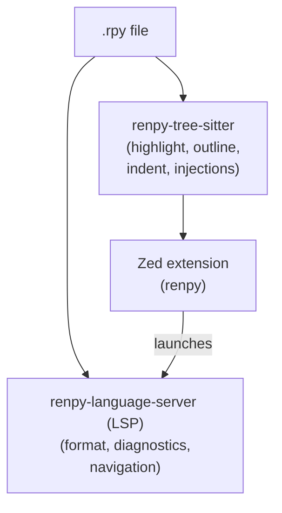

# renpy-zed

Ren'Py support for the [Zed](https://zed.dev) editor: syntax highlighting,
embedded Python, outline, indentation and formatting through a language server.

> **Status: 0.2.0.** Install the language server with
> `uv tool install renpy-language-server`.

> Unofficial project, not affiliated with Ren'Py.

## Features

- Tree-sitter grammar for `.rpy` and `.rpym`: dialogue, labels, menus,
  `scene`/`show`/`hide`, `define`/`default`, screens, ATL, styles, layered
  images and translations
- Python highlighting inside `python:` blocks, `$` lines,
  `python_expression` fragments and bracket groups
- Outline for labels, menus, defines, defaults, images, screens, transforms,
  styles, layered images, translations, test cases, Python classes and their
  members, and stores
- Format on save through [`renpy-language-server`](https://github.com/rockettap/renpy-language-server),
  a Ren'Py formatter and language server with configurable whitespace, operator
  spacing and quote normalization
- Configurable diagnostics for indentation, tabs, filename conventions,
  variable names, comparisons, stray `$`, obsolete APIs, unknown labels and
  images, undefined screens, persistent/store variables and duplicate labels,
  with per-rule severity and open-file or whole-workspace modes
- Go to definition for labels, screens, transforms, images, layered images,
  characters, styles and variables, including local labels, automatic images
  and unambiguous Python member access (`self.x`, `Class.x`, `persistent.x`,
  `store.x`)
- Find references for the same families across the workspace, with an option to
  exclude declarations
- Signature help for Ren'Py built-ins, labels and screens, plus user classes,
  functions and `self.` / `Class.` methods
- Diagnostics quick fixes through `renpy-language-server`: comparison typos, stray `$`,
  leading tabs and missing labels
- Rename labels (global and local), screens, transforms, images, characters,
  styles and `define` / `default` variables across the workspace
- Occurrence highlighting for the symbol under the cursor, including while
  renaming
- Hover for declarations, references, automatic images, Python classes and
  members, persistent variables and Ren'Py built-ins, with signatures, comment
  documentation and source locations
- Completion for statements, labels, images (including automatic images),
  screens, characters, transforms, transitions, audio channels/assets, API
  namespaces, screen elements/properties/values, dialogue attributes and
  Python expressions, plus class members after `Class.` / `self.`,
  persistent fields and store variables
- Completion documentation rendered as Markdown, including fenced signatures and
  inline code
- Opt-in semantic tokens for declarations, references, built-ins, obsolete
  APIs, keywords, parameters and literals
- Snippets for labels, menus, characters, screens, text/image buttons, layered
  images, transforms, styles, translations, Python and init blocks, plus
  control flow, scene/show/hide, audio, assertions, test cases and regions
- Vim text objects for labels, screens, transforms, layered images, test cases,
  styles, menus and Python/init blocks
- Runnable labels and Zed tasks for run, run-from-line, run-from-label, lint,
  compile, dialogue and `rmpersistent`, with `RENPY_SDK` and common-install
  SDK discovery
- Launch-only debugger through `renpy-language-server dap`: start the game, warp to a line,
  stream output and terminate it from the debug panel
- Prefixed string auto-closing (`r"`, `f'`, `b"""`, and friends), backticks and
  Markdown ` ```renpy ` fence injection
- Folding ranges and selection formatting from the language server

## How it works

Three repositories, three jobs:

| Component             | Repository                                                                              | Language                   | Role                                                       |
| --------------------- | --------------------------------------------------------------------------------------- | -------------------------- | ---------------------------------------------------------- |
| Zed extension `renpy` | [`rockettap/renpy-zed`](https://github.com/rockettap/renpy-zed)                         | Rust (launcher) + queries  | Registers the language, ships queries, launches the server |
| Grammar               | [`rockettap/renpy-tree-sitter`](https://github.com/rockettap/renpy-tree-sitter)         | JavaScript DSL + C scanner | Parses Ren'Py constructs, exposes Python fragments         |
| Language server       | [`rockettap/renpy-language-server`](https://github.com/rockettap/renpy-language-server) | Python (uv, pygls)         | Formatting, diagnostics, navigation, completion and DAP    |



`extension.toml` pins the grammar repository to a fixed revision. Zed clones
that revision, compiles `src/parser.c` to WebAssembly, and never runs
`tree-sitter generate`. The generated parser is committed in the grammar
repository; the extension repository does not vendor a copy.

### Design decisions

- **Tree-sitter, not TextMate.** Zed requires a tree-sitter grammar for every
  language an extension defines. The syntax tree is also what outline,
  auto-indent, injections and the formatter need.
- **Python via injection, not a custom parser.** The grammar marks Python
  fragments (`python:` bodies, `$` lines, expressions in `define`, `default`,
  `if` and bracket groups), and `injections.scm` hands them to Zed's built-in
  Python grammar. `[interpolation]` is deliberately not injected because the
  token includes Ren'Py-only format suffixes such as `[value:.2f]`.
- **Grammar in its own repository.** Zed clones the grammar repository at a
  pinned revision, so the grammar stays free of extension code and can be
  tested with `tree-sitter test` on its own.
- **The server is not bundled.** Zed's extension rules require language
  servers to be downloaded or found in the user's environment, not shipped
  inside the extension. `renpy-language-server` is distributed through PyPI and launched
  through `PATH`, `uvx` or `uv tool run`.
- **Queries are validated in CI.** A stale node name makes a whole `.scm` file
  fail to compile, and Zed then shows no highlighting at all.
  `scripts/check-grammar.sh` parses fixtures and compiles every query against
  the pinned grammar revision.

## Install

### 1. Install the language server

```bash
uv tool install "renpy-language-server>=0.2,<0.3"
```

`renpy-language-server` requires Python 3.10 or newer.

For development, install from a clone instead:

```bash
git clone https://github.com/rockettap/renpy-language-server
uv tool install --editable ./renpy-language-server
```

### 2. Install the extension

Once the extension is published, install **Ren'Py** from the Zed extension
catalog. To try the current source, clone this repository, run
**`zed: install dev extension`**, and select the cloned directory.

Zed compiles extensions to `wasm32-wasip2`; with Rust installed via `rustup`
the target is added automatically.

### 3. Point Zed at the server if it is not on `PATH`

`renpy-language-server` is the server ID from `extension.toml`:

```json
{
  "lsp": {
    "renpy-language-server": {
      "binary": {
        "path": "/home/you/.local/bin/renpy-language-server"
      }
    }
  }
}
```

This is usually needed on macOS when Zed is started from the GUI and does not
inherit the shell `PATH`.

### 4. Set up the Ren'Py SDK for run, lint and debug

The extension ships **Ren'Py: run game**, **run from line**, **run from label**,
**lint**, **compile**, **dialogue** and **remove persistent** tasks, plus a
launch-only debugger. They look for the SDK in
`RENPY_SDK` first, then in `renpy-*-sdk` directories under your home
directory, `Documents`, `Downloads`, `Desktop` and `Applications` (newest
version first):

```bash
export RENPY_SDK="$HOME/renpy-8.5.3-sdk"
```

`RENPY_SDK` may name either the SDK directory or its launcher. The tasks use a
POSIX shell, so they currently work on macOS and Linux; Windows-native task
support is a follow-up. The debugger itself is cross-platform because it runs
`renpy-language-server dap` and lets Python start the SDK.

Snippets, text objects and editor overrides need no configuration.

### 5. Debug the game

Add a configuration to `.zed/debug.json` (or the global `debug.json` from the
command palette):

```json
[
  {
    "label": "Ren'Py: run game",
    "adapter": "renpy",
    "request": "launch"
  },
  {
    "label": "Ren'Py: run from cursor",
    "adapter": "renpy",
    "request": "launch",
    "warp": "$ZED_FILE:$ZED_ROW"
  }
]
```

The same configurations also appear as debug variants beside the run tasks
(the ▶ menu) once the extension is installed. Supported fields are `sdk`,
`project`, `warp`, `command` (`run`, `lint`, `compile`, ...), `args`, and
`env`:

```json
[
  {
    "label": "Ren'Py: run with a clean save",
    "adapter": "renpy",
    "request": "launch",
    "sdk": "/Applications/renpy-8.5.3-sdk",
    "project": "$ZED_WORKTREE_ROOT",
    "warp": "game/script.rpy:42",
    "env": { "RENPY_SKIP_SPLASHSCREEN": "1" }
  }
]
```

This release starts and stops the game only. Breakpoints, stepping, stack
traces, variables and attaching to a running game are not supported yet;
`setBreakpoints` reports the lines as unverified and stepping requests return
a clear message.

`warp` must point at a script inside the project's `game/` directory and at a
line inside a label. Ren'Py only loads scripts from `game/`, so pointing at a
copy elsewhere (for example a `legacy/` folder in the project root) would fail
deep inside the engine. The adapter checks the target first and suggests the
matching game script instead:

```text
warp target "legacy/dlc_day_two.rpy" is not loaded by Ren'Py: it resolves to
".../game/legacy/dlc_day_two.rpy", which does not exist. Ren'Py only loads
scripts from ".../game". Did you mean "game/legacy_dlc_day_two.rpy"?
```

### 6. Enable format on save

```json
{
  "languages": {
    "Ren'Py": {
      "formatter": "language_server",
      "format_on_save": "on"
    }
  }
}
```

## Development

### Extension

```bash
cargo fmt --check
cargo clippy --target wasm32-wasip2 -- -D warnings
cargo test --lib
cargo build --release --target wasm32-wasip2
```

`cargo build` produces `target/wasm32-wasip2/release/renpy_zed.wasm`. Zed
builds this for dev extensions too; the file is not committed.

### Grammar and queries

The grammar lives in the separate `renpy-tree-sitter` repository:

```bash
cd ../renpy-tree-sitter
npx --yes tree-sitter-cli@0.25.10 generate
npx --yes tree-sitter-cli@0.25.10 test
npx --yes tree-sitter-cli@0.25.10 parse examples/smoke.rpy
```

`src/parser.c`, `src/grammar.json` and `src/node-types.json` are generated and
must be committed. CI regenerates them and fails if the committed output
differs.

Validate this repository's queries against the pinned grammar:

```bash
scripts/check-grammar.sh
```

To use a local grammar checkout instead of cloning the pinned revision:

```bash
RENPY_GRAMMAR_DIR=../renpy-tree-sitter scripts/check-grammar.sh
```

For local extension development, point Zed at a local grammar by changing
`extension.toml` temporarily:

```toml
[grammars.renpy]
repository = "file:///absolute/path/to/renpy-tree-sitter"
rev = "<commit>"
```

Remember to restore the `https://` repository and the pinned revision before
committing.

### Server

```bash
cd ../renpy-language-server
uv sync
uv run pytest
uv run ruff check . && uv run ruff format --check .
uv run pyright
```

### Formatting tests

The `renpy-language-server` tests cover formatting, idempotency, CRLF handling,
minimal LSP edits and a real stdio server round trip. The formatter has also
been validated against real Ren'Py scripts (see below).

## Repository layout

```
renpy-zed/
├── extension.toml              # id = "renpy", grammar + language server
├── Cargo.toml                  # crate-type = ["cdylib"], zed_extension_api
├── src/lib.rs                  # LSP/DAP resolution, launch and scenarios
├── snippets/ren'py.json        # language snippets (scope = Ren'Py)
├── debug_adapter_schemas/
│   └── renpy.json              # launch-only debug configuration schema
├── languages/renpy/
│   ├── config.toml             # name, suffixes, brackets and overrides
│   ├── highlights.scm
│   ├── injections.scm          # python -> "python"
│   ├── indents.scm
│   ├── brackets.scm
│   ├── outline.scm
│   ├── textobjects.scm         # Vim text objects
│   ├── overrides.scm           # string/comment scopes
│   ├── runnables.scm           # run button on labels
│   └── tasks.json              # run, warp, lint, compile, dialogue and rmpersistent tasks
├── scripts/check-grammar.sh    # parse fixtures + compile all queries
├── tests/fixtures/smoke.rpy    # every supported construct
├── tests/test_extension_assets.py
├── tests/test_tasks.py
├── .github/workflows/ci.yml
├── CONTRIBUTING.md             # local checks and grammar-change process
├── LICENSE
├── NOTICE.md                   # upstream grammar/query attribution
└── CHANGELOG.md
```

## Grammar quality

`tests/fixtures/smoke.rpy` exercises every supported construct and is parsed in
CI. The grammar repository also has `tree-sitter test` corpus coverage for
labels, menus, Python, screens/ATL and text parts.

## Troubleshooting

- **`Could not find a compatible 'renpy-language-server' server`** — install it with
  `uv tool install renpy-language-server`, or set `lsp.renpy-language-server.binary.path`. Zed started
  from the GUI often does not inherit `~/.local/bin` from the shell.
- **The server starts but formatting does nothing** — check that the language
  is `Ren'Py`, that `formatter` is `language_server`, and that `format_on_save`
  is `on`.
- **No highlighting at all** — a query failed to compile. Run
  `scripts/check-grammar.sh`; a single stale node name disables the whole
  query file.
- **`Library not loaded: @executable_path/librenpython.dylib` on macOS** — the
  downloaded Ren'Py SDK is still quarantined, so Gatekeeper refuses to load its
  ad-hoc-signed library. Clear the flag once and relaunch:
  `xattr -dr com.apple.quarantine /Applications/renpy-8.5.3-sdk`. This is an SDK
  issue and also happens when running `renpy.sh` from a terminal, not something
  the debugger or `renpy-language-server` causes.
- **Grammar checkout fails** — `extension.toml` pins a commit that must exist
  in `rockettap/renpy-tree-sitter`.

## Acknowledgements and prior art

- [`ZeynTheDev/tree-sitter-renpy`](https://github.com/ZeynTheDev/tree-sitter-renpy):
  the original grammar this project is derived from (MIT).
- [`Ozicom23/zed-renpy`](https://github.com/Ozicom23/zed-renpy): grammar
  extensions and the query base this project started from (MIT).
- [`renpy/vscode-language-renpy`](https://github.com/renpy/vscode-language-renpy):
  reference for Ren'Py language support.
- [`tree-sitter-python`](https://github.com/tree-sitter/tree-sitter-python):
  reference for the indentation scanner and Python injections.

See [`NOTICE.md`](NOTICE.md) for the full attribution.

## License

MIT. See [`LICENSE`](LICENSE).
