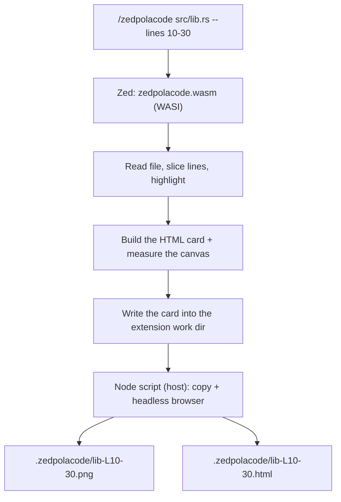

# Zed Polacode

[](https://github.com/talhayksk/zedpolacode/actions/workflows/ci.yml)
[](LICENSE)

Polacode-style code snapshots for [Zed](https://zed.dev): turn a file or a line
range into a shareable **PNG** code card (plus the standalone **HTML** it was
rendered from).


```text
/zedpolacode src/main.rs --lines 120-160 --theme tokyo-night --bg gradient
```

> **Naming:** the project, repository and Rust crate are **Zed Polacode**
> (`zedpolacode`), and the slash command is `/zedpolacode`. The registry ID is
> `zpolacode` — extension IDs may not contain the word `zed`, so the `d` is
> dropped. See [PUBLISHING.md](PUBLISHING.md).

> **Distribution status:** install this as a **dev extension**. It is not on the
> Zed extension registry — Zed no longer accepts slash-command extensions in the
> registry, see [PUBLISHING.md](PUBLISHING.md) for the exact quotes and for the
> alternatives.

---

## Install

### As a dev extension (recommended)

```bash
git clone https://github.com/talhayksk/zedpolacode.git
```

1. Open the command palette in Zed.
2. Run `zed: install dev extension`.
3. Select the cloned `zedpolacode` directory (the one with `extension.toml`).

Zed compiles the extension itself. Rust must be installed via [rustup](https://rust-lang.github.io/rustup/);
Zed installs the `wasm32-wasip2` target for you.

### From source / manual build

```bash
rustup target add wasm32-wasip2
cargo build --release --target wasm32-wasip2
# -> target/wasm32-wasip2/release/zedpolacode.wasm
```

### Requirements

- A recent Zed (extension API `0.7.x`).
- **PNG rendering** needs Chrome, Edge, Chromium or Brave. Without one, the
  command still works: it writes the HTML card and explains why there is no PNG.
  Set `ZEDPOLACODE_BROWSER` to a browser binary to pick one explicitly.
- Node is used to hand the card over to the host; Zed ships its own runtime.

---

## Why a slash command?

Zed extensions cannot draw UI, and the WASI sandbox they run in can only write to
the extension's own directory. The slash command is the only interactive surface
the extension API exposes, and the actual file writes are performed by a host
process (Node + a headless browser) that the extension spawns.

The extension API also does not expose the current editor selection, so the line
range is passed explicitly with `--lines` (use `Ctrl+G` / `Cmd+G` in Zed to see
line numbers).

---

## Usage

Open the assistant panel and run:

```text
/zedpolacode src/store.rs --lines 40-70
/zedpolacode src/App.tsx --theme nord --bg gradient
/zedpolacode --file crates/core/src/lib.rs --lines 1-25 --title "core/lib.rs"
```

A code block works too, even without an open project:

```text
/zedpolacode ```rust
let snapshot = capture(&buffer);
```
```

Output is written to `.zedpolacode/` in the project:

```text
.zedpolacode/store-L40-70.png
.zedpolacode/store-L40-70.html
```

Add `.zedpolacode/` to your project's `.gitignore`.

---

## Options

| Option | Description |
| --- | --- |
| `--lines <a-b>` | Line range: `40-70`, `40:70`, `40..70`, `40-` (to the end of file) |
| `--lang <id>` | Force the language (also detected from the file extension) |
| `--theme <id>` | Color theme |
| `--bg <name\|#hex>` | Background: `transparent`, `gradient`, `sunset`, `ocean`, `aurora`, `midnight`, `mono`, `dark`, `light`, or a hex color such as `#1e1e2e` |
| `--title <text>` | Title bar text (defaults to the file name) |
| `--font-size <px>` | Font size, 9-40 (default 15) |
| `--padding <px>` | Inner padding, 0-120 (default 34) |
| `--radius <px>` | Corner radius, 0-48 (default 14) |
| `--no-line-numbers` | Hide line numbers |
| `--no-window` | Hide the title bar and window dots |
| `--no-shadow` | Turn the drop shadow off |
| `--out <dir>` | Output folder (default `.zedpolacode`, may be absolute) |
| `--format <png\|html\|both>` | Output format (default `png`) |

`/zedpolacode --help` lists the current set; arguments also have completions.

### Themes

`dracula` (default), `one-dark`, `nord`, `tokyo-night`, `github-dark`,
`catppuccin-mocha`, `github-light`, `solarized-light`

### Languages

`rust`, `python`, `javascript`, `typescript`, `go`, `c`, `cpp`, `csharp`,
`java`, `kotlin`, `swift`, `ruby`, `php`, `shell`, `sql`, `lua`, `zig`, `html`
(markup), `css`, `json`, `yaml`, `toml`, `plaintext`

---

## How it works



- **Highlighting**: a dependency-free scanner (`src/highlight.rs`) for comments,
  strings (including triple-quoted and multi-line), numbers, keywords, calls,
  types and constants, plus dedicated rules for HTML, CSS, YAML, TOML and JSON.
- **Measuring**: the canvas is sized from the longest line (0.62 monospace
  advance ratio, CJK counts as two columns). PNGs are captured at `@2x`.
- **Transparency**: `--bg transparent` (default) produces a real alpha channel.
- **Resilience**: if the PNG cannot be rendered the command still succeeds with
  the HTML card and explains why.

### Project layout

| Path | Contents |
| --- | --- |
| `src/lib.rs` | Slash command, argument flow, dedent, summary, completions |
| `src/options.rs` | Slash-command flag parsing (builds `CardOptions`) |
| `src/host.rs` | Node invocation, path/warning translation |
| `src/zedpolacode.js` | Host side: file writes, browser discovery, `--screenshot` |
| `crates/core/src/highlight.rs` | Dependency-free tokenizer + language definitions |
| `crates/core/src/theme.rs` | Color palettes |
| `crates/core/src/render.rs` | HTML card generation and canvas measurement |
| `crates/core/src/options.rs` | `CardOptions`, background presets and validation |

The engine lives in `crates/core` (`polacode-core`) and has no dependency on
`zed_extension_api`, so the same code can drive an MCP server. Unit tests live in
`#[cfg(test)]` blocks; `write_preview_artifact` is an `#[ignore]`d test that
writes a card to disk for manual inspection.

---

## Development

```bash
cargo fmt --check
cargo test --workspace
cargo build --release --target wasm32-wasip2
```

To exercise the Node/browser path by hand:

```bash
cargo test write_preview_artifact -- --ignored --nocapture
# HTML=/tmp/zedpolacode-preview.html  W=811 H=606 SCALE=2
node src/zedpolacode.js '{"mode":"file","html":"<path>","outDir":"<dir>","base":"preview","w":811,"h":606,"scale":2,"png":true,"wait":1200,"useTmp":false}'
```

Try a different look:

```bash
ZEDPOLACODE_PREVIEW_ARGS="--theme nord --bg gradient" cargo test write_preview_artifact -- --ignored --nocapture
```

### Troubleshooting

- Nothing happens? Open the log with `zed: open log`.
- Need verbose output (including `println!`/`dbg!` from the extension)? Quit Zed and
  relaunch it from a terminal with `zed --foreground`.
- Re-installing? Run `zed: install dev extension` on the same directory again —
  Zed replaces the previous build.

---

## Contributing

Issues and PRs are welcome. For larger changes please open an issue first.
`cargo fmt` and `cargo test` must be green.

## License

[MIT](LICENSE) © Talha Yüksek
